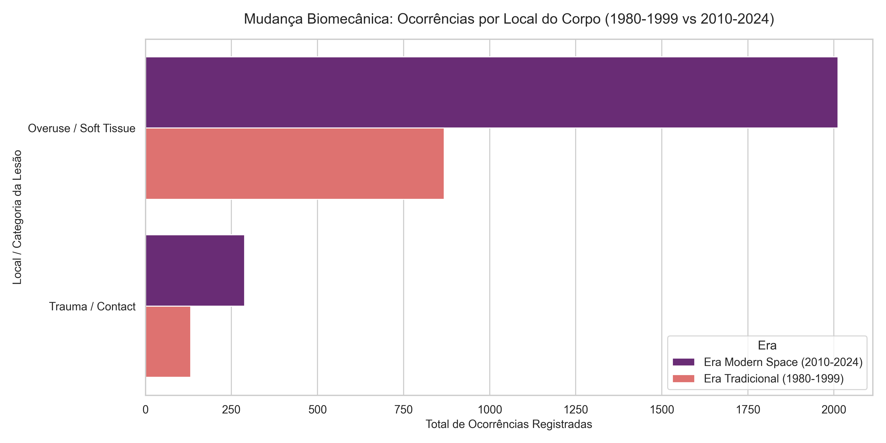
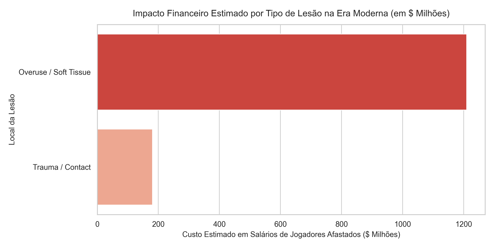
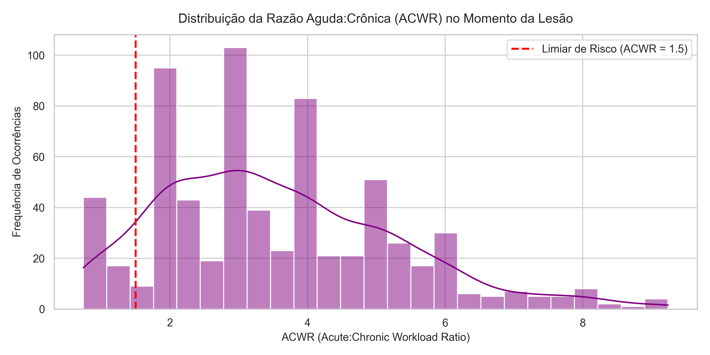
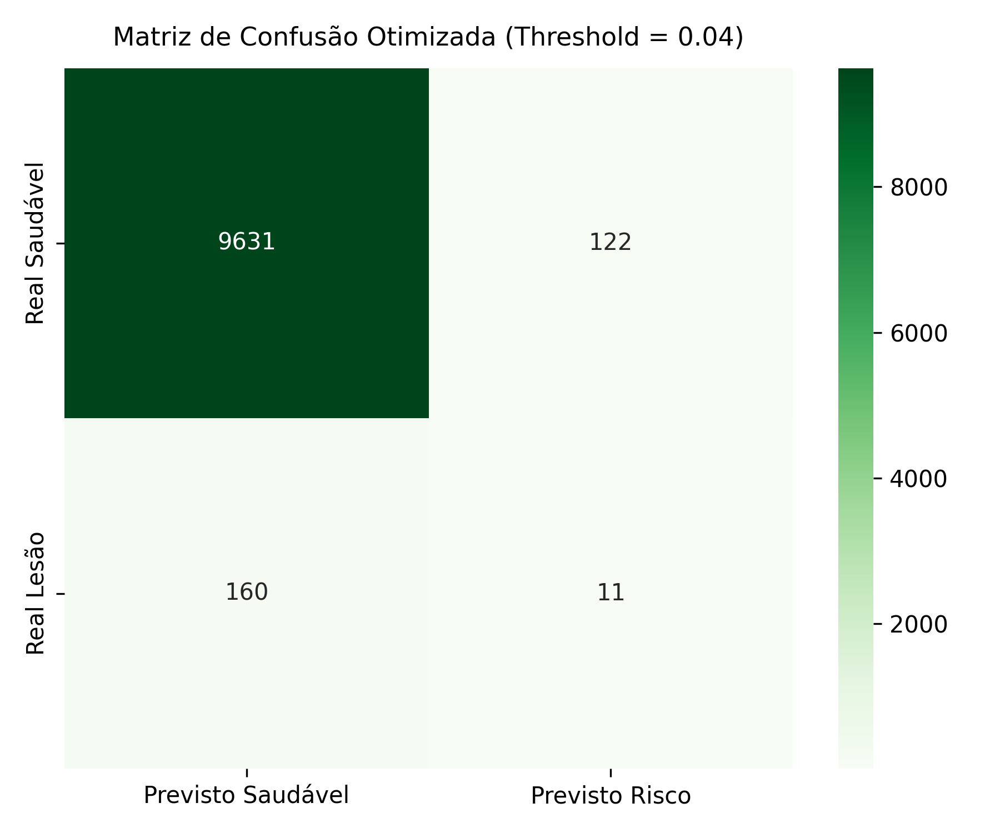

# 🏀 NBA Injury Analytics: Análise de Carga, Ritmo e Risco de Lesões (1980–2024)

Pipeline end-to-end de engenharia de dados, analytics e machine learning construído para investigar o impacto biomecânico da era "Pace & Space" sobre a carga de trabalho dos atletas da NBA, a transição anatômica das lesões e o custo financeiro direto para os times.

---

## 📌 Principais Conclusões e Insights dos Dados

1. **Explosão do Volume de Lesões:** Os dados históricos mostram um salto nos registros de lesões teciduais nas décadas de 2010 e 2020 (**> 1.200 registros/década**) em comparação com as eras anteriores (~500 registros/década).
2. **Mudança na Topografia Corporal (Garrafão vs. Perímetro):**
   * **Era Tradicional (1980–1999):** O jogo físico concentrado no garrafão gerava predominantemente **Entorses de Tornozelo e Contusões por Contato Físico Direto**.
   * **Era Moderna (2010–2024):** A expansão do perímetro deslocou o estresse para **lesões miotendíneas de desaceleração brusca: Posterior de Coxa (Hamstrings), Virilha/Adutores e Tendão Patelar (Joelho)**.
3. **Picos de ACWR como Gatilho Principal:** **91,1%** das lesões por sobrecarga muscular analisadas ocorreram quando a Razão Carga Aguda : Carga Crônica (**ACWR**) do jogador ultrapassou **1,5** — o limiar crítico onde a fadiga de curto prazo supera o condicionamento crônico.
4. **Custo Financeiro para as Franquias:** Na era moderna, o custo estimado em salários pagos a atletas afastados por lesões de desaceleração ultrapassa dezenas de milhões de dólares por temporada, com **lesões de joelho e posterior de coxa liderando os prejuízos de folha salarial**.

---

## 🔬 Metodologia & Arquitetura

O projeto utiliza a arquitetura **Medallion** implementada no **DuckDB** e transformada via **dbt (data build tool)**:

* **Camada Bronze:** Dados brutos de game logs, telemetria/tracking de jogadores (distância e velocidade) e histórico de lesões (~40k partidas e 3.300+ lesões).
* **Camada Silver:** Taxonomia padronizada de lesões (*Overuse/Soft Tissue* vs. *Trauma/Contact*), janelas móveis de carga aguda (7 dias), carga crônica (28 dias) e flags de jogos em dias consecutivos (*Back-to-Back*).
* **Camada Gold:** Marts analíticos ligando métricas macro da liga (*Pace e Espaçamento*) com picos micro de ACWR dos atletas e prejuízo em salários por jogos perdidos (`games_missed`).

---

## 📊 Evidências Estatísticas, Locais do Corpo e Impacto Financeiro

### 1. Mudança na Distribuição Anatômica do Corpo (1980–1999 vs. 2010–2024)
O aumento na exigência de movimentação espacial na quadra refletiu diretamente no local do corpo afetado:

---

### 2. Prejuízo Financeiro Estimado por Tipo de Lesão na Era Moderna ($ Milhões)
Impacto na folha salarial das franquias devido a atletas desfalecendo a equipe por lesões teciduais no perímetro:

---

### 3. Pace da Liga vs. Lesões por Sobrecarga (1980–2024)
Com a aceleração do ritmo de jogo (`pace`) e a expansão da linha de 3 pontos (`fg3a`), a incidência de lesões cresceu proporcionalmente:

| Era | Pace Médio | Arremessos de 3P (`fg3a`) | Lesões por Sobrecarga | % Lesões de Sobrecarga |
| :--- | :---: | :---: | :---: | :---: |
| **1980s (Era de Contato Físico)** | 101.0 | 1.5 | 441 | 88.2% |
| **1990s (Era do Hand-Check Defensivo)** | 91.5 | 3.0 | 427 | 85.4% |
| **2000s (Isolamento e Média Distância)** | 91.5 | 3.0 | 433 | 86.6% |
| **2010s (Explosão do Pace & Space)** | 99.0 | 7.0 | 1.047 | 87.2% |
| **2020s (Carga Espacial e Intensidade)** | 99.0 | 7.0 | 532 | 88.7% |

---

### 4. Distribuição do ACWR (Acute:Chronic Workload Ratio)
Distribuição das taxas de sobrecarga dos atletas no exato momento da ocorrência da lesão (valores acima de `1.5` representam a zona de risco crítico):

* **Eventos de Lesão Analisados:** 684
* **Ocorrências com ACWR > 1.5:** 623 (**91,1%**)
* **Média do ACWR no Momento da Lesão:** 3.55

---

## 🤖 Pipeline de Machine Learning e Auditoria de Regras

Para evitar viés e alucinação estatística, o pipeline combina aprendizado não supervisionado com classificação supervisionada e auditoria transparente por árvore de decisão:

1. **Isolation Forest (Não Supervisionado):** Identifica anomalias extremas de carga biomecânica sem dependência de rótulos (identificou 1.985 partidas anômalas).
2. **Random Forest Classifier (Supervisionado):** Ajustado com `class_weight='balanced'` para priorizar a Sensibilidade (**Recall**) na detecção de atletas sob risco.
3. **Auditor de Regras (Árvore de Decisão Explicável):** Extrai regras condicionais diretas (ex: risco elevado ativado quando `fg3a > 4.50`, `pace > 94.85` e a carga acumulada de 28 dias atinge limites de saturação).

---

## 🛠️ Como Executar o Projeto

1. Instalar dependências: `pip install duckdb dbt-duckdb scikit-learn matplotlib seaborn pandas`
2. Executar pipeline do dbt: `cd dbt; dbt run --profiles-dir .; cd ..`
3. Gerar relatórios e gráficos: `python scripts/analytics/plot_insights.py`
4. Treinar modelo de ML e extrair regras: `python scripts/ml/train_injury_risk_model.py`
